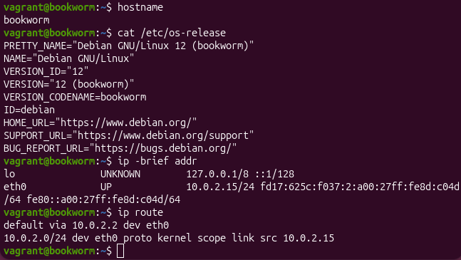
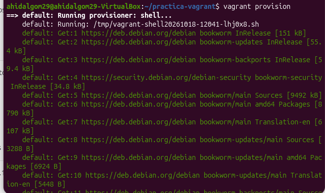
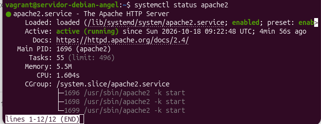
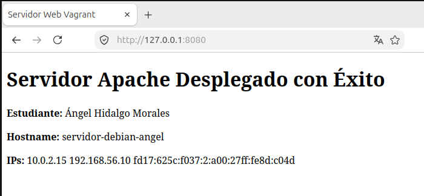

**Estudiante:** Ángel Hidalgo Morales
**Curso:** 2º ASIR

---

- **Vagrant**: Herramienta CLI para la creación y gestión de entornos de desarrollo virtualizados de forma reproducible y portable. Resuelve el problema del *"en mi equipo funciona"* encapsulando la infraestructura en código.
- **Anfitrión (Host)**: Sistema operativo base donde se ejecuta Vagrant y el hypervisor.
- **Proveedor (Provider)**: Motor de virtualización encargado de gestionar las máquinas virtuales (ej. VirtualBox, VMware).
# Práctica: Despliegue de entorno virtualizado con Vagrant

**Estudiante:** Ángel Hidalgo Morales
**Curso:** 2º ASIR
**Centro:** IES Albarregas 

---

## Parte A: Investigación Teórica

### 1. Vagrant y el Vagrantfile

#### Problema que resuelve Vagrant
Vagrant permite automatizar la creación y gestión de entornos de desarrollo reproducibles mediante código (Infrastructure as Code), eliminando el problema de "en mi máquina funciona".

#### Conceptos clave
- Vagrant: Herramienta de línea de comandos para la creación y gestión de entornos virtuales.
- Anfitrión (Host): Sistema operativo base donde se ejecuta Vagrant y el hipervisor.
- Proveedor (Provider): Motor de virtualización encargado de gestionar las máquinas virtuales (VirtualBox).
- Box: Plantilla empaquetada o imagen base inmutable del sistema operativo (debian/bookworm64).
- Máquina Virtual (Guest): Instancia aislada generada sobre el proveedor.

#### Lenguaje y análisis del Vagrantfile
El archivo Vagrantfile está escrito en Ruby (sintaxis DSL).

Bloque de configuración del Vagrantfile:
Vagrant.configure("2") do |config|
  config.vm.box = "debian/bookworm64"
  config.vm.hostname = "servidor-debian-angel"
  config.vm.network "private_network", ip: "192.168.56.10", virtualbox__intnet: "red-laboratorio"
  config.vm.network "forwarded_port", guest: 80, host: 8080, host_ip: "127.0.0.1"
  config.vm.provision "shell", path: "setup_apache.sh"
end

- config.vm.box: Define la imagen base (Debian 12). Comprobación: cat /etc/os-release.
- config.vm.hostname: Define el nombre de host de la VM. Comprobación: hostname.
- config.vm.network "private_network": Asigna una red interna aislada con IP fija (192.168.56.10). Comprobación: ip -brief addr.
- config.vm.network "forwarded_port": Mapea el puerto 8080 del anfitrión al 80 de la VM para acceder al servidor web. Comprobación: Navegar a http://127.0.0.1:8080.
- config.vm.provision: Ejecuta el script de aprovisionamiento setup_apache.sh. Comprobación: systemctl status apache2.

---

### 2. Aprovisionamiento (Provisioning)

- Provisioner: Mecanismo para automatizar la instalación y configuración del software dentro de la VM con permisos de root.
- inline: vs path:: inline: ejecuta comandos escritos dentro del propio Vagrantfile. path: ejecuta un script externo en un archivo separado (setup_apache.sh).
- Reejecución del script: Si se modifica el script tras el primer vagrant up, los cambios no se aplican solos; hay que ejecutar vagrant provision.

---

### 3. Interfaces y Redes

- Red por defecto (NAT): Vagrant la crea automáticamente en la interfaz eth0 para dotar a la VM de acceso a Internet y permitir la conexión SSH administrativa. Añadir una segunda interfaz no elimina la NAT.
- Comparativa de redes:
  - NAT: Acceso a Internet, aislada del host y de otras VMs.
  - Red Interna (Intnet): Comunicación directa entre VMs de la misma red física virtualizada. Sin acceso a la red física ni al host.
  - Red Privada (Host-Only): Comunicación entre la VM y el host.
  - Red Pública (Bridged): La VM se integra como un equipo más en la red física del anfitrión.
- VirtualBox vs VMware: La red interna de VirtualBox aísla el tráfico entre VMs sin darle IP directa al host; la red host-only de VMware sí conecta directamente al host con la VM.
- Forwarded Ports: Redirige puertos concretos sobre la interfaz NAT existente; no genera una interfaz nueva.

---

### 4. Órdenes y Carpeta Compartida

Tabla de comandos:
- vagrant up: Despliega y arranca la máquina virtual. [Ejecutado: Sí]
- vagrant status: Muestra el estado actual de la VM. [Ejecutado: Sí]
- vagrant ssh: Abre una terminal interactiva por SSH. [Ejecutado: Sí]
- vagrant reload: Reinicia la VM aplicando cambios del Vagrantfile. [Ejecutado: Sí]
- vagrant provision: Ejecuta de nuevo los scripts de aprovisionamiento. [Ejecutado: Sí]
- vagrant halt: Apaga la VM de forma limpia. [Ejecutado: Sí]
- vagrant destroy: Elimina la VM y sus recursos en disco. [Ejecutado: Sí]

- Carpeta /vagrant: Es un directorio sincronizado automáticamente (Synced Folder) entre la raíz del proyec- **Box**: Plantilla empaquetada o imagen base del sistema operativo utilizada como punto de partida.
- **Máquina Virtual (Guest)**: Instancia aislada generada sobre el proveedor.


El archivo `Vagrantfile` está escrito en **Ruby** (utilizando su sintaxis de DSL).

- **Provisioner**: Mecanismo de Vagrant para automatizar la instalación de software tras el arranque de la VM. Se ejecuta dentro de la máquina virtual (`Guest`) con privilegios de superusuario (`root`).
- **Diferencia entre `inline:` y `path:`**:
  - `inline:` Escribe los comandos Bash directamente en el `Vagrantfile`.
  - `path:` Hace referencia a un script externo (ej. `setup_apache.sh`).
- **Modificación del script**: Si se modifica el script tras el primer `vagrant up`, no se aplica automáticamente. Para forzar su reejecución se utiliza `vagrant provision` o `vagrant reload --provision`.

- **Red por defecto (NAT)**: Es la primera interfaz (`eth0`) asignada por Vagrant para mantener comunicación SSH y otorgar salida a Internet.
- **Diferencias entre redes**:
  - **NAT**: Permite salida a Internet a la VM. El anfitrión no puede acceder directamente a la VM sin reenvío de puertos.
  - **Red Interna (VirtualBox)**: Comunicación exclusiva entre máquinas virtuales dentro del mismo hypervisor.
  - **Red Privada Host-Only**: Comunicación bidireccional entre el anfitrión y la máquina virtual.
  - **Red Pública (Bridged)**: Conecta la VM directamente a la red física local.
- **Diferencia VirtualBox vs VMware**: La red interna de VirtualBox aísla las VMs sin permitir acceso desde el anfitrión. Host-Only en VMware crea un adaptador virtual que permite comunicación Host <-> Guest.
- **Preguntas clave**:
  - Añadir la segunda interfaz **no** elimina la interfaz NAT predeterminada.
  - El reenvío de puertos **no** crea una nueva interfaz, sino que añade un mapeo en el proveedor NAT.

| Orden | Descripción | Ejecutado |
| :--- | :--- | :---: |
| `vagrant up` | Crea y/o arranca la máquina virtual. | [x] |
| `vagrant status` | Muestra el estado actual de la máquina virtual. | [x] |
| `vagrant ssh` | Abre una sesión SSH interactiva dentro de la VM. | [x] |
| `vagrant reload` | Reinicia la VM y aplica cambios del Vagrantfile. | [x] |
| `vagrant provision` | Reejecuta los scripts de aprovisionamiento. | [x] |
| `vagrant halt` | Apaga de forma controlada la VM. | [x] |
| `vagrant destroy` | Elimina completamente la VM y sus recursos. | [x] |


El directorio `/vagrant` dentro de la VM es una carpeta compartida (*Synced Folder*) que mapea en tiempo real el directorio del proyecto situado en el anfitrión.

## Parte C: Configuración Completa del Vagrantfile

### 1. Definición de la Infraestructura en Código
Se ha configurado el archivo `Vagrantfile` para incluir el hostname personalizado, la segunda interfaz en red interna, el reenvío del puerto web y el aprovisionamiento automatizado:

```ruby
Vagrant.configure("2") do |config|
  config.vm.box = "debian/bookworm64"
  config.vm.hostname = "servidor-debian-angel"
  config.vm.network "private_network", ip: "192.168.56.10", virtualbox__intnet: "red-laboratorio"
  config.vm.network "forwarded_port", guest: 80, host: 8080, host_ip: "127.0.0.1"
  config.vm.provision "shell", path: "setup_apache.sh"
end
```
---

### 2. Análisis de las Interfaces de Red y Rutas en Debian

Tras aplicar los cambios con vagrant reload y acceder por SSH (vagrant ssh), se verificó la asignación de red:

- Primera Interfaz (eth0 - NAT):
  - Dirección y ruta: Recibe la IP 10.0.2.15/24 vía DHCP y asigna la ruta predeterminada default via 10.0.2.2 dev eth0.
  - Función: Proporciona salida a Internet a la VM y permite la gestión SSH administrativa desde el anfitrión.
- Segunda Interfaz (eth1 - Red de laboratorio):
  - Dirección: Configurada estáticamente en 192.168.56.10/24.
  - Función: Permite la comunicación en la red interna aislada red-laboratorio.

---

### 3. Diferencia entre Red Interna (VirtualBox) y Red Host-Only (VMware)

- Red Interna (Intnet en VirtualBox): Aísla el tráfico exclusivamente entre las máquinas virtuales conectadas a esa misma etiqueta de red. El sistema operativo anfitrión no tiene acceso directo por IP a esta interfaz.
- Red Privada Host-Only (en VMware): Crea una tarjeta de red virtual en el equipo anfitrión que le permite comunicarse directamente por IP con las máquinas virtuales, actuando como una red privada local entre el anfitrión y los invitados.

---

### 4. Reenvío de Puertos y Aprovisionamiento
- Forwarded Port: Mapea las peticiones dirigidas al puerto 8080 de la interfaz local del anfitrión (127.0.0.1) hacia el puerto 80 del servidor web en la VM.
- Provisioner: Asocia el script externo setup_apache.sh para automatizar el despliegue de Apache.

---

### 5. Evidencia Fotográfica



## Parte D: Aprovisionamiento Automatizado del Servidor Apache

### 1. Script de Aprovisionamiento (setup_apache.sh)
Para automatizar la instalación y configuración del servidor web, se ha desarrollado el script Bash setup_apache.sh:

#!/usr/bin/env bash
# Actualizar la lista de paquetes e instalar el servidor web Apache2
apt-get update -y
apt-get install -y apache2

# Habilitar y arrancar el servicio de Apache
systemctl enable apache2
systemctl start apache2

# Crear la página web index.html personalizada con variables del sistema
cat <<EOF> /var/www/html/index.html
<!DOCTYPE html>
<html lang="es">
<head>
    <meta charset="UTF-8">
    <title>Servidor Web Vagrant</title>
</head>
<body>
    <h1>Servidor Apache Desplegado con Éxito</h1>
    <p><b>Estudiante:</b> Ángel Hidalgo Morales</p>
    <p><b>Hostname:</b> $(hostname)</p>
    <p><b>Dirección IP:</b> $(hostname -I)</p>
</body>
</html>
EOF

---

### 2. Explicación de las Órdenes del Script
1. apt-get update -y: Actualiza los repositorios de paquetes de Debian sin solicitar interacción.
2. apt-get install -y apache2: Instala el servidor HTTP Apache.
3. systemctl enable apache2: Registra el servicio para que se inicie automáticamente en cada arranque de la máquina.
4. systemctl start apache2: Inicia el servicio de inmediato.
5. cat <<EOF > /var/www/html/index.html: Sustituye la página por defecto de Apache con una estructura HTML personalizada que lee dinámicamente el hostname y las IP asignadas mediante la ejecución de comandos en el script.

---

### 3. Reejecución Exclusiva del Aprovisionamiento
Si se modifica el script de aprovisionamiento o la configuración del servidor web con la máquina ya en marcha, no es necesario destruirla ni reiniciarla. Vagrant permite forzar la ejecución del aprovisionador mediante la orden:

vagrant provision

---

### 4. Evidencias Fotográficas y Verificación

#### A) Salida del comando vagrant provision


#### B) Estado del servicio dentro de la máquina virtual


#### C) Acceso al servidor web desde el anfitrión

